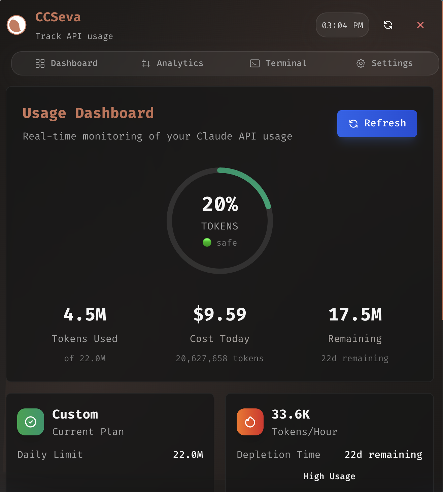

# Exhausted Model

See in the macOS menu bar how much of your Claude Code limit is left.

```sh
brew tap snupk/tap && brew trust snupk/tap && brew install --cask exhausted-model
```

Apple Silicon, macOS 14+.



## What it shows

- How much of the 5-hour limit is left, right in the menu bar
- 5-hour and weekly limits with reset countdowns
- Tokens and cost by day, model and project
- Notifications at 70% and 90%

## Privacy

Everything is read locally from `~/.claude/projects`. Your Claude Code token goes only to `api.anthropic.com`, the same way Claude Code uses it. Sync with claudecode.directory is optional and off by default.

---

Forked from [CCSeva](https://github.com/Iamshankhadeep/ccseva). MIT license. Not affiliated with Anthropic. Build from source: [`swift/README.md`](swift/README.md).

## Update or remove

```sh
brew upgrade --cask exhausted-model
brew uninstall --cask exhausted-model
```
